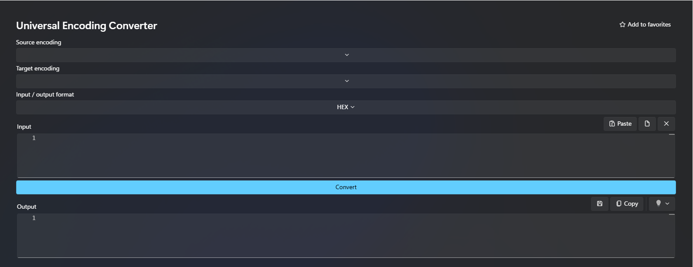

# DevToys Universal Encoding Converter

Source project for DevToys 2.x (.NET 8).



## Build

```powershell
dotnet restore
dotnet build -c Release
dotnet pack -c Release
```

Install the resulting `.nupkg` from DevToys > Manage extensions.

**Important:** This project has not been compiled or runtime-tested in this environment (the .NET SDK is unavailable). The `DevToys.Api` version may need adjustment to match your installation.

## Usage

- HEX: input and output are hexadecimal representations of bytes.
- Base64: input and output are Base64 representations of bytes.
- Text: Unicode input is encoded into the source encoding and decoded from the target; this is a round-trip and does not recover unknown original bytes.
- Strict fallback raises errors on unmappable characters.
- BOM and automatic encoding detection are not implemented.
